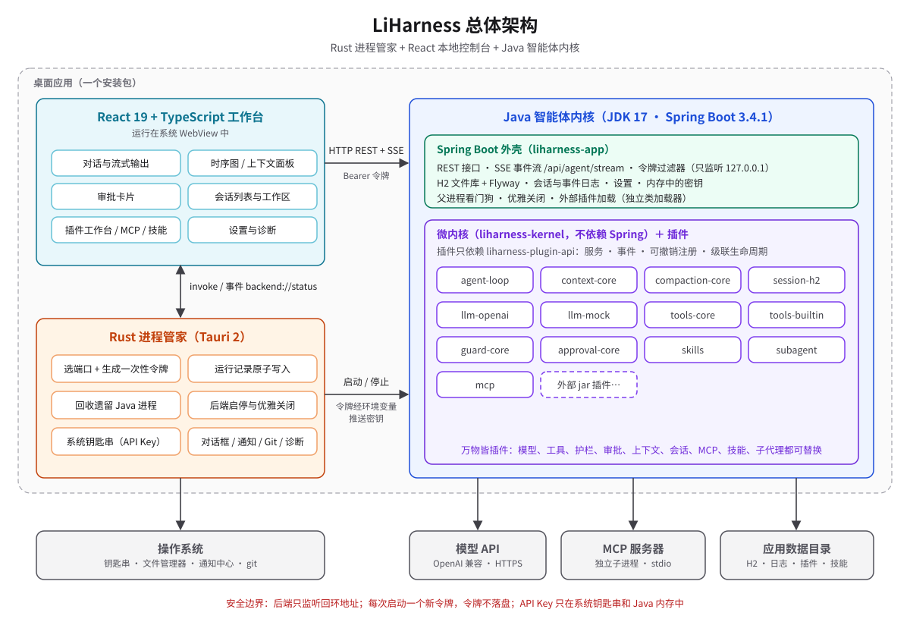

<div align="center">

# LiHarness

**万物皆插件的桌面 AI Agent Harness**

Java 智能体内核 · Tauri 2 原生外壳 · React 本地控制台

[](docs/roadmap.md)
[](https://openjdk.org/)
[](https://spring.io/projects/spring-boot)
[](https://v2.tauri.app/)
[](LICENSE)

[这是什么](#这是什么) · [架构](#架构) · [技术栈](#技术栈) · [学习路线](#学习路线) · [路线图](docs/roadmap.md) · [参与贡献](CONTRIBUTING.md)

</div>

---

## 这是什么

LiHarness 是一个跑在桌面上的 **AI Agent Harness（智能体运行框架）**，同时也是一套从零实现它的教程。

Harness 是包在大模型外面的那层运行时：组装上下文、调用模型、执行工具、守护安全边界、管理会话与记忆。Anthropic 在 [Building effective agents](https://www.anthropic.com/engineering/building-effective-agents) 里总结过：表现好的 Agent 往往不依赖复杂框架，本质是**模型在循环里根据环境反馈调用工具**。

LiHarness 在此基础上走得更远一步：**万物皆插件**。模型适配器、工具、会话存储、护栏策略、审批、甚至 Agent 循环本身，都是可以替换、启用、禁用的插件。内核只负责插件的生命周期、服务注册和事件分发。

## 核心特性（规划中）

| 能力 | 说明 |
|---|---|
| 🧩 插件微内核 | 插件声明依赖，依赖就绪才加载；卸载时自动撤销它注册的一切 |
| 🔁 Agent Loop | 模型 ⇄ 工具循环，带不变量校验与最大步数保险丝；循环本身也是插件 |
| 🌊 流式输出 | OpenAI 兼容协议，SSE 增量推送文本、工具调用、审批请求与错误 |
| 🛡️ 护栏与审批 | 策略链插件 + 人工审批（human-in-the-loop），白名单外的命令必须用户批准 |
| 📊 全程可观测 | 执行时序图、上下文构成、token 水位，每一步都看得见 |
| 💾 会话持久化 | H2 文件库 + 追加式事件日志，支持恢复与回放 |
| 🔌 MCP / Skills / 子代理 | 以插件形式接入 |
| 🖥️ 原生桌面 | Tauri 2 负责进程生命周期与本机能力，前端不直接暴露命令执行面 |

## 架构



一句话：**智能体逻辑全部在 Java，桌面外壳只负责进程生命周期、本机能力和低延迟的流式交互。** 详见 [架构设计](docs/architecture.md) 与 [插件架构](docs/plugin-architecture.md)。

## 技术栈

| 层 | 选择 |
|---|---|
| 后端语言 | Java 17（LTS） |
| 应用框架 | Spring Boot 3.4.1（只用于应用层，内核与插件接口不依赖 Spring） |
| 构建 | Maven 多模块 + Maven Wrapper |
| 存储 | H2 文件数据库 + Flyway 迁移 |
| 桌面外壳 | Tauri 2（Rust） |
| 前端 | React 19 + TypeScript + Vite |
| 通信 | 本机 HTTP（REST + SSE），每次启动生成令牌 |
| 打包 | jlink 精简 JRE + Tauri bundler |

选型理由见 [技术选型](docs/tech-stack.md) 与 [架构决策记录](docs/adr/README.md)。

## 学习路线

教程在 [`docs/guide/`](docs/guide/)，每章结构固定：**本章目标 → 为什么 → 知识点 → 跟着写 → 验收标准 → 常见坑 → 练习**。

| 阶段 | 章节 |
|---|---|
| 地基 | [00 环境准备](docs/guide/00-setup.md) · [01 后端骨架](docs/guide/01-backend-skeleton.md) · [02 桌面骨架与 Rust 进程管家](docs/guide/02-desktop-shell.md) · [03 流式通道](docs/guide/03-streaming.md) |
| 内核 | [04 插件微内核](docs/guide/04-plugin-kernel.md) · [05 协议层与 Mock 模型](docs/guide/05-protocol-and-mock.md) · [06 最小 Agent Loop](docs/guide/06-agent-loop.md) · [07 工具层](docs/guide/07-tools.md) · [08 对接真模型](docs/guide/08-openai-model.md) · [09 提示词与上下文](docs/guide/09-prompt-and-context.md) |
| 工程化 | [10 执行观测](docs/guide/10-observability.md) · [11 护栏与审批](docs/guide/11-guardrails-approval.md) · [12 会话持久化与密钥](docs/guide/12-sessions.md) · [13 上下文压缩](docs/guide/13-compaction.md) |
| 生态 | [14 外部插件与热插拔](docs/guide/14-external-plugins.md) · [15 MCP 接入](docs/guide/15-mcp.md) · [16 技能系统](docs/guide/16-skills.md) · [17 子代理](docs/guide/17-subagent.md) · [18 原生能力](docs/guide/18-native-capabilities.md) |
| 交付 | [19 打包发布与评测](docs/guide/19-release-and-eval.md) |

> ✅ 全部 20 章已完成。每章末尾的 git tag（如 `m06-agent-loop`）可以作为进度检查点。

## 目录结构

```text
LiHarness/
├── pom.xml                          # Maven 父工程
├── backend/
│   ├── liharness-plugin-api/        # 插件契约：Plugin、PluginContext、服务接口、协议类型
│   ├── liharness-kernel/            # 微内核：插件生命周期、服务栈、事件；外部插件加载器
│   ├── plugins/                     # 内置插件，每个一个模块
│   │   ├── liharness-plugin-agent-loop/
│   │   ├── liharness-plugin-llm-openai/
│   │   ├── liharness-plugin-tools-builtin/
│   │   ├── liharness-plugin-mcp/
│   │   └── …
│   ├── liharness-app/               # Spring Boot 应用：REST + SSE、H2、组装内核
│   └── liharness-eval/              # 评测：无界面组装内核，跑标准任务
├── desktop/                         # Tauri 2 应用
│   ├── src/                         # React 19 + TypeScript
│   └── src-tauri/                   # Rust 进程管家与原生能力
├── examples/hello-plugin/           # 外部插件示例（独立 Maven 工程）
├── eval/                            # 评测用例与 fixture
├── scripts/                         # 构建运行时、设置版本号
└── docs/                            # 架构、ADR、教程、架构图
```

## 快速开始

> 代码随教程逐章实现，以下命令在对应章节完成后可用。

```bash
# 后端单独运行（第 01 章起）
./mvnw -pl backend/liharness-app -am spring-boot:run

# 桌面应用（第 02 章起）
cd desktop && npm install && npm run tauri dev
```

## 安全

LiHarness 会让模型在你的电脑上读写文件、执行命令。后端只监听 `127.0.0.1`，每次启动生成随机令牌，所有危险操作经过护栏与人工审批。发现安全问题请按 [SECURITY.md](SECURITY.md) 私下报告。

## 参与贡献

欢迎 Issue 和 PR，尤其是新插件、教程勘误和各平台的踩坑记录。开始前请阅读 [CONTRIBUTING.md](CONTRIBUTING.md) 与 [行为准则](CODE_OF_CONDUCT.md)。

## 致谢

- Anthropic：[Building effective agents](https://www.anthropic.com/engineering/building-effective-agents)、[Effective context engineering for AI agents](https://www.anthropic.com/engineering/effective-context-engineering-for-ai-agents)
- [Tauri](https://tauri.app/)、[Spring Boot](https://spring.io/projects/spring-boot)、[Model Context Protocol](https://modelcontextprotocol.io/)

## 许可证

[MIT](LICENSE) © 2026 Pubbge
