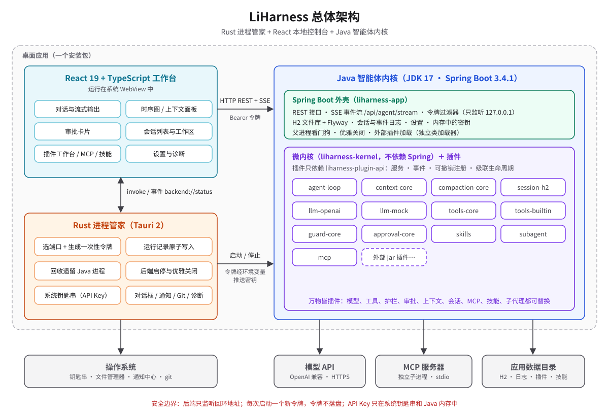
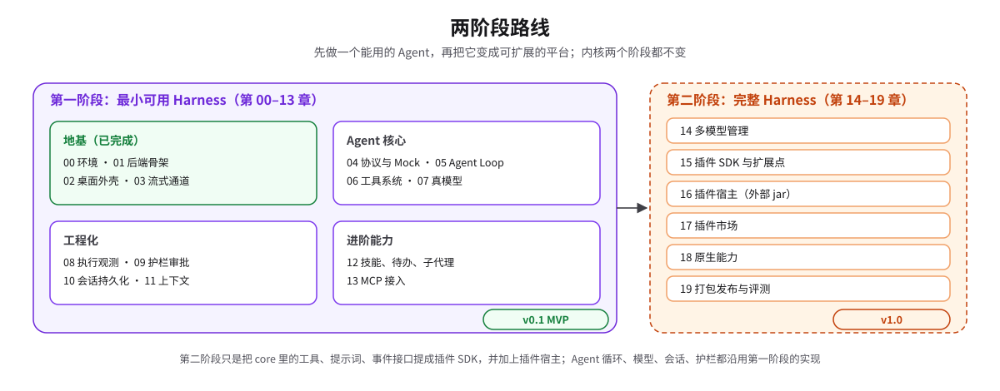

# 架构设计

> 这份文档描述 LiHarness 的**目标形态**，以及我们怎样分两个阶段走到那里。读教程时卡住了，回来对照“我现在写的这块在整张图的哪里”。

## 1. 一句话

> **Rust 进程管家 + React 本地控制台 + Java 智能体后端；后端是“固定内核 + 扩展点插件”。**

- 智能体逻辑全部在 Java；桌面外壳只负责进程生命周期、本机能力和流式交互。
- Java 后端里，**模型适配、Agent 循环、会话存储、上下文管理、护栏与审批是固定的内核**，插件不能替换它们。
- 插件只能通过几个明确的**扩展点**增加能力：工具、提示词段落、钩子、事件订阅、技能。



## 2. 两个阶段

| | 第一阶段：最小可用 Harness（MVP） | 第二阶段：完整 Harness |
|---|---|---|
| 目标 | 一个能用的桌面 Agent：对话、工具、护栏、会话、上下文、技能、子代理、MCP | 可扩展的平台：插件 SDK、外部插件、插件市场、多模型 |
| 后端模块 | `liharness-plugin-api`（只有 `Tool`）+ `liharness-core` + `liharness-app` | plugin-api 补上插件 SDK，app 里加插件宿主 |
| 怎么加一个工具 | 在 core 模块的 `domain.tool` 下写一个类，注册到工具表 | 写一个插件 jar，放进插件目录 |
| 模型 | 模型注册表：内置常用 provider + `~/.liharness/settings.yaml` 覆盖，OpenAI 兼容协议 + Mock；一个默认模型 | 每个会话单独选模型、界面里管理 provider、备用模型、更多协议 |
| 教程 | 第 00–14 章 | 第 15–20 章 |

**为什么先做 MVP？** 先把“模型在循环里调用工具”这件事完整跑通，你才会真正知道哪些地方需要扩展、扩展点该长什么样。一上来就设计插件系统，很容易设计出用不上的抽象。第一阶段的代码按分层（领域 / 基础设施 / 用例 / 触发）和“端口 + 实现”组织，第二阶段只是把其中几个接口提出来做成插件 SDK，不需要推倒重来。



## 3. 三层职责

| 层 | 负责 | 不负责 |
|---|---|---|
| **React 控制台** | 展示、交互、把事件流归一化成界面状态 | 不执行任何命令，不直接读写文件 |
| **Rust 进程管家** | 后端进程生命周期；令牌；本机能力（目录选择、Git 状态、外部跳转、通知、诊断） | 不包含任何智能体逻辑 |
| **Java 后端** | 智能体的一切：Agent 循环、模型、工具、护栏、审批、会话、上下文、插件宿主 | 不感知自己运行在桌面还是服务器 |

**为什么这样切？** 智能体能力只在一个地方实现（Java），桌面版与将来的 Web 版、CLI 共用同一套后端；前端没有命令执行面，被注入了也做不了危险的事。

## 4. 后端模块与依赖方向


| 模块 | 阶段 | 依赖 | 说明 |
|---|---|---|---|
| `liharness-plugin-api` | 一（第 06 章起） | 无（只依赖 JDK） | **对外契约**，包 `domain.spi`。第一阶段只有工具接口 `Tool`、`ToolContext`、`ToolResult`；（二）加上 `Plugin`、`PluginContext`、`HookPoint` 等。插件作者只依赖它 |
| `liharness-core` | 一 | plugin-api + Jackson + SnakeYAML | **领域层 + 基础设施层，纯 Java，不依赖 Spring**。领域层：模型端口、Agent 循环、工具、权限、会话、上下文、技能、子代理、MCP 的规则；基础设施层：Mock / OpenAI 兼容适配器、YAML 配置、本机文件与命令、JSONL 存储、MCP stdio 客户端 |
| `liharness-app` | 一 | core + Spring Boot | 用例层（`cases`）、触发层（`trigger`：REST + SSE、令牌校验）、装配与进程生命周期（`app`）；（二）插件宿主 |
| 外部插件 jar | 二 | plugin-api（provided） | 第三方或你自己写的插件，放进插件目录即可加载 |

依赖规则：

- `core` 不依赖 Spring：它能在单元测试和评测程序里直接 `new` 出来运行（Maven Enforcer 检查）；
- 插件只依赖 `plugin-api`，看不到 `core` 和 `app` 的内部类（独立类加载器保证）；
- 包**按层分**，层内再按领域分（见下一节）。层之间的依赖方向由两个架构测试检查：core 模块的 `ArchitectureTest`、app 模块的 `AppArchitectureTest`。

### 4.1 分层与包结构

包名的分层参考 deepseek-harness-java（DDD 六边形架构的写法，这里只借用分层和命名）。完整的取舍见 [模型流与包结构](design/model-stream-and-packages.md)。

```text
trigger ──► cases ──► domain ◄── infrastructure
                         ▲
                   app（装配）把 infrastructure 的实现作为 domain 的接口交给 Spring
```

| 层 | 包 | 放什么 | 不能依赖 |
|---|---|---|---|
| 领域层 | `domain.<领域>` | 规则和流程：值对象、实体、领域服务，以及它需要外部提供的接口（端口、仓储） | infrastructure、cases、trigger、app、Spring |
| 基础设施层 | `infrastructure.adapter.<领域>` | 端口和仓储的实现：模型适配器、本机文件 / 命令 / 网络、JSONL 存储、MCP 客户端 | cases、trigger、app、Spring |
| 用例层 | `cases.<领域>` | 一个完整的业务流程：跑一个回合、选模型、管理会话、审批 | infrastructure、trigger |
| 触发层 | `trigger.http` · `trigger.filter` · `trigger.service.stream` | 协议翻译：REST、SSE、令牌校验 | infrastructure |
| 装配 | `app.config` · `app.lifecycle` | Spring 配置（new 出 infrastructure 的实现交给 Spring）、进程生命周期 | — |

领域内部的约定：

| 子包 | 放什么 | 例子 |
|---|---|---|
| `adapter/port/` | 领域要外部提供的能力（模型端口叫 `LlmChatModelAdapter`，其余 `I` 开头） | `LlmChatModelAdapter`、`ILlmAdapterFactory`、`IFsPort`、`IShellExecutor`、`IApprovalGateway` |
| `adapter/repository/` | 领域要的存取能力，`I` 开头 | `ISessionRepository`、`ISettingsRepository`、`ICredentialRepository`、`IMcpConfigRepository` |
| `contract/outbound/` | 领域往外发消息的契约 | `ITurnEventListener` |
| `model/valobj/` | 值对象（不可变 record） | `FsPath`、`TurnRequest`、`Settings`、`PermissionDecision`（llm 领域按功能分包，见下） |
| `model/entity/` | 实体（有身份） | `SessionMeta`、`Skill` |
| `service/` | 领域服务（规则） | `ResponseAssembler`、`LlmProviderRegistry`、`AgentLoop`、`PermissionPolicy`、`McpServerRegistry` |

```text
liharness-plugin-api  com.pubbge.liharness.domain.spi.tool   Tool · ToolArgs · ToolContext · ToolResult · ToolException

liharness-core  com.pubbge.liharness
├── domain/
│   ├── shared/         cancel/（CancellationToken）· json/（Json）· validate/（Texts）
│   ├── llm/            adapter/port/   LlmChatModelAdapter · LlmStream · ILlmAdapterFactory        ← 第 04、05 章
│   │                   message/        Message · Role
│   │                   tool/           ToolCall · ToolSpec
│   │                   stream/         StreamChunk · FinishReason
│   │                   exchange/       LlmRequest · LlmResponse · TokenUsage
│   │                   error/          LlmException
│   │                   provider/       ModelRef · ProviderConfig · ModelConfig · ModelProfile         ← 第 05 章
│   │                   service/        ResponseAssembler · LlmGenerationService · LlmStreams
│   │                                   BuiltinProviders · LlmProviderRegistry（第 05 章）· RetryingLlmPort（第 08 章）
│   ├── agent/          service/run/    AgentLoop                                                   ← 第 06 章
│   │                   service/subagent/  TaskTool · SubagentSettings                              ← 第 13 章
│   │                   model/valobj/   TurnRequest · TurnResult · TurnOutcome · TurnEvent · AgentOptions
│   │                   contract/outbound/  ITurnEventListener
│   ├── tool/           service/        ToolExecutor · SchemaValidator · ToolOutputLimiter · BuiltinTools  ← 第 06、07 章
│   │                   model/valobj/   ToolSet · ToolOutcome · ToolCallScope
│   │                   time/ · todo/ · skill/ · fs/ · shell/ · web/ · mcp/   具体的工具，带着各自的端口和值对象
│   │                   （fs: IFsPort · FsPath；shell: IShellExecutor；web: IWebFetchPort；
│   │                    mcp: McpTool · McpServerRegistry · IMcpClientPort · IMcpClientFactory · IMcpConfigRepository）
│   ├── permission/     service/        PermissionPolicy · ToolGate · RuleGate · ModeGate · DangerousCommandGate …  ← 第 10 章
│   │                   adapter/port/   IApprovalGateway
│   ├── session/        adapter/repository/  ISessionRepository · service/ HistoryRepair · model/entity/ SessionMeta  ← 第 11 章
│   ├── settings/       adapter/repository/  ISettingsRepository · ICredentialRepository · model/valobj/ Settings  ← 第 05、08、10 章
│   ├── context/        service/compaction/ · service/token/ · service/prompt/ · adapter/port/ IProjectInstructionsPort  ← 第 12 章
│   └── skill/          service/ SkillCatalog · SkillParser · adapter/port/ ISkillFilePort · model/entity/ Skill  ← 第 13 章
└── infrastructure/
    ├── adapter/llm/            mock/（MockAdapterFactory · MockLlmAdapter · ScriptedLlmAdapter）· openai/（OpenAiAdapterFactory · OpenAiCompatibleAdapter …）
    ├── adapter/fs/ · shell/ · web/     LocalFsAdapter · LocalShellExecutor · JdkWebFetchAdapter
    ├── adapter/repository/     JsonlSessionRepository · InMemorySessionRepository · YamlSettingsRepository · YamlCredentialRepository
    ├── adapter/context/ · skill/      FileProjectInstructions · LocalSkillFileAdapter
    ├── adapter/mcp/            StdioMcpClient · JsonRpcChannel · McpConfigFile
    └── support/                process/ChildProcesses（子进程的安全规则）· yaml/YamlFile · YamlSections · AtomicFiles

liharness-app  com.pubbge.liharness
├── LiHarnessApplication
├── cases/      agent/（TurnCase · TurnRegistry · TurnTools · SystemPrompts · ContextPolicyFactory）· approval/ · session/
│               settings/（ModelCase · SecretRedactor）· skill/ · mcp/
├── trigger/    http/（各个 Controller）· filter/（TokenAuthFilter）· service/stream/（SseTurnListener · LoggingTurnListener）
└── app/        config/（HarnessHome 配置目录；每个领域一个装配类：LlmConfig · ToolConfig · AgentConfig · PermissionConfig · SessionConfig · McpConfig）
                lifecycle/（ShutdownCoordinator · ParentWatchdog）
```

领域之间的依赖：`agent → tool / permission / context / skill / llm`，`context → llm`，`tool.mcp → tool 的接口`，`shared` 不依赖任何人。反过来都不行。比如 `TaskTool` 需要 `AgentLoop`，所以它在 `agent.service.subagent` 里，而不是 `tool` 里。

**规则在领域层，机制在基础设施**：文件工具的“先读后改”在 `domain.tool.fs`，防符号链接逃逸在 `infrastructure.adapter.fs`；命令工具的超时上限在 `domain.tool.shell`，杀进程树在 `infrastructure.adapter.shell`；网页工具的防 SSRF 在 `domain.tool.web`，发 HTTP 请求在 `infrastructure.adapter.web`；MCP 服务器的状态机在 `domain.tool.mcp.service`，stdio 和 JSON-RPC 在 `infrastructure.adapter.mcp`。

### 4.2 模型接口

```java
public interface LlmChatModelAdapter {
    String id();
    LlmStream stream(LlmRequest request);              // 唯一的生成入口，立即返回一个流
}
public interface LlmStream extends AutoCloseable {
    StreamChunk next() throws LlmException;            // 拉一个片段；最后一个一定是 Finish
    void close();                                      // 任何线程都可以调用，用来取消
}
// StreamChunk：TextDelta · ReasoningDelta · ToolCallDelta(index, id, name, argumentsDelta) · Usage · Retry · Finish
```

- **适配器只翻译**：把各家的原始数据翻译成细粒度的片段，不拼装。
- **领域层拼装**：`ResponseAssembler` 按 index 拼工具调用，并统一整理各家的不规范（有工具调用就是 `TOOL_USE`、截断时丢掉半截的工具调用、补 id）。
- **领域服务负责读流**：`LlmGenerationService.generate(request, cancel, observer)` 开流、把片段交给 observer 和拼装器、用 `cancel.onCancel(stream::close)` 把取消接到流上、保证关流。Agent Loop、模型测试、摘要器都调用它。
- **重试是装饰器**：`RetryingLlmPort` 包在任何端口外面，重试前发一个 `Retry` 片段给界面。
- **用哪个模型由注册表决定**：`LlmProviderRegistry` 把“内置 provider 目录 + `settings.yaml` 里的覆盖 + Key（`.credentials.yaml` 优先，其次环境变量）+ 按协议注册的适配器工厂”合在一起。模型写成 `provider/model`，每个回合现取，改配置不用重启。适配器按**协议**注册（`openai-completions`、`mock`），加一家兼容 OpenAI 的服务只要改配置。

为什么是“拉”而不是 deepseek-harness-java 那样的“推”（`Flow.Publisher`），见 [ADR-0011](adr/0011-pull-based-model-stream.md)。以后接入 Spring AI 等框架，也只是实现这个端口（[ADR-0009](adr/0009-external-orchestration-via-adapters.md)）。

## 5. 内核与扩展点

这是第二阶段的核心设计，详见 [插件与扩展点](plugin-architecture.md)。一句话：

| 固定的内核（插件不能替换） | 开放的扩展点（插件可以增加） |
|---|---|
| 模型适配与模型列表 | 工具 |
| Agent 循环 | 提示词段落 |
| 会话存储（JSONL，只追加） | 钩子：会话开始、用户输入、工具调用前 / 后、回合结束 |
| 上下文组装与压缩 | 事件订阅 |
| 护栏与审批的主流程 | 技能（插件可以附带技能目录） |

内核的每一块在代码里仍然是“接口 + 默认实现”（端口与适配器）。**开发者**可以改代码替换实现（比如把 JSONL 换成数据库），但这属于改项目本身，不属于插件能力。

第一阶段已经留好的接缝：`ToolGate`（第 10 章，将来的 `PRE_TOOL_USE` 钩子就是一个 gate）、`SystemPromptBuilder` 的段落（第 12 章，段落顺序之间留了空位）、`ITurnEventListener`（事件订阅）、`TurnTools`（每个回合组装工具，插件工具从这里加入）。


## 6. 启动与退出


要点：

- **端口由 Rust 选**：`TcpListener::bind("127.0.0.1:0")` 让系统分配空闲端口，读出端口号后立即释放，再交给 Java。释放和 Java 绑定之间有极短的竞争窗口，Java 启动失败时 Rust 换一个端口重试。
- **运行记录**原子写入（先写临时文件再 rename），**不包含令牌**。
- **回收遗留进程**前核对进程的命令行确实包含我们的 jar 路径，防止 PID 被系统复用后误杀无关进程。
- **日志重定向**到 `<应用数据目录>/logs/backend.log`，就绪判断靠健康检查轮询，不依赖解析 stdout。
- **退出**：Rust 收到 `RunEvent::Exit` 后请求 `POST /api/admin/shutdown`，最多等 5 秒，超时只强制终止我们自己启动的那个子进程。
- **父进程看门狗**：Java 每隔 2 秒检查 Tauri 进程是否还在，不在了就自行优雅退出，不会留下孤儿进程。

## 7. 一次对话回合


SSE 事件类型（前端归一化的依据）：

| event | 含义 | 章 |
|---|---|---|
| `turn_started` | 回合开始（回合 id、模型） | 06 |
| `delta` | 模型输出的一小段文本 | 06 |
| `reasoning` | 推理模型的一小段思考过程（只显示，不进历史） | 08 |
| `retry` | 模型调用失败，马上自动重试（第几次、原因、等多久） | 08 |
| `tool_call` / `tool_result` | 工具调用与结果（含耗时） | 06 |
| `tool_progress` | 工具的进度（命令输出的最新一行、子代理正在调用的工具） | 07、13 |
| `approval_required` / `approval_resolved` | 需要用户批准的操作 / 审批结果 | 10 |
| `context` | 发给模型前估算的上下文用量和窗口大小 | 12 |
| `compacted` | 回合中做了一次摘要式压缩 | 12 |
| `done` | 回合结束（结局、最终回答、步数、token 用量、耗时） | 06、09 |
| `error` | 出错或被停止（带错误分类） | 06、08 |

待办清单（第 13 章）没有单独的事件：前端从最后一次 `todo_write` 调用的参数里画出清单。

第二阶段的钩子插在这条链路的固定位置上：用户输入进来时（`USER_PROMPT_SUBMIT`）、每次执行工具前后（`PRE_TOOL_USE` / `POST_TOOL_USE`）、回合结束时（`TURN_END`）。钩子能观察、能拦截工具调用，但不能改变循环本身。

## 8. Agent Loop 的不变量

写错这些，模型 API 会直接返回 400，或者模型会“失忆”：

1. **assistant 的 tool_calls 消息必须原样放回上下文**，不能改写成普通文本；
2. **每个 `tool_call_id` 都必须有一条对应的 tool 消息**，被拒绝、执行失败、超时都要回填原因；
3. **没有 tool_calls 就是最终回答**，这是唯一的正常出口；
4. **最大步数保险丝**，防止死循环；
5. **工具错误不中断循环**，错误作为观察交给模型，让它自己修正。

## 9. 并发模型（JDK 17）

| 场景 | 做法 |
|---|---|
| Agent 回合 | 专用线程池（core = max = 8，有上限）；每个会话同一时刻只允许一个回合 |
| SSE 推送 | `SseEmitter`；回合线程把事件交给 SSE 出口写出 |
| 模型调用 | `java.net.http.HttpClient` 流式读取；读线程把行放进阻塞队列，回合线程从 `LlmStream.next()` 拉取（推转拉） |
| MCP 服务器 | 每个服务器一个读线程，按 JSON-RPC 的 id 把响应交给等待的调用方；stderr 另有线程读取；后台启动 |
| 子代理 | 在主回合的线程上嵌套运行同一个 `AgentLoop`；取消令牌挂在主回合的令牌上 |
| 审批等待 | `CompletableFuture` + 超时；用户的决定由 REST 接口完成这个 Future |
| 取消 | 每个回合一个取消令牌；调模型前、执行工具前检查；模型流、子进程、MCP 请求都通过 `onCancel` 注册中止动作 |
| 工具子进程 | `IShellExecutor` 的本机实现：`ProcessBuilder` + 超时 + 销毁整个进程树；去掉 `LIHARNESS_` 开头的环境变量 |

## 10. 数据落盘

用户的配置和数据放在**配置目录**（默认 `~/.liharness`，可以用环境变量 `LIHARNESS_HOME` 或启动参数 `--liharness.home` 改），给人看、给人改；运行时的东西放在 Tauri 给的**应用数据目录**。

```text
~/.liharness/
├── settings.yaml            # 默认模型、自定义 provider（第 05 章）、权限规则（第 10 章）；不含 API Key
├── .credentials.yaml        # API Key（第 05 章），权限 600；也可以只用环境变量
├── sessions/<id>.jsonl      # 会话（第 11 章）：每行一条消息 / 改名 / 压缩，只追加
├── skills/<名字>/SKILL.md   # 用户级技能（第 13 章）
├── mcp.json                 # MCP 服务器配置（第 14 章），沿用 MCP 生态通用的 mcpServers 格式
└── plugins/                 # 外部插件 jar（第二阶段）

<应用数据目录>/
├── runtime/backend.json     # 运行记录：pid、port、jarPath、startedAt（无令牌）
└── logs/backend.log         # 后端日志（已脱敏）

<工作区>/
├── LIHARNESS.md 或 AGENTS.md    # 项目说明，自动进入系统提示词（第 12 章）
└── .liharness/skills/           # 项目级技能（第 13 章）
```

为什么分两个目录：配置是用户的选择，要好找、能手改、能备份到别的电脑（Claude Code 的 `~/.claude`、DeepSeek Harness 的 `~/.dsh` 都是这样）；应用数据目录在 macOS 上是 `~/Library/Application Support/<应用标识>`，适合放用户不用关心的运行时文件。

API Key 只在两个地方出现：`.credentials.yaml`（或用户自己的环境变量）和 Java 进程内存。不进 `settings.yaml`、不进日志、没有任何接口把它返回给前端；工具输出里出现的 Key 会被抹掉（第 10 章）。

## 11. 安全边界

| 边界 | 措施 | 章节 |
|---|---|---|
| 其他程序 → 后端 | 只监听回环地址 + 随机端口 + 启动令牌；不开放 CORS | 01、02 |
| 前端 → 本机 | 前端没有命令执行能力；Tauri capability 只开放固定 command | 02、19 |
| 模型 → 文件 | 工作区沙箱 | 07 |
| 模型 → 命令 | 护栏策略 + 人工审批 | 10 |
| 子代理 → 本机 | 子代理的每个工具调用照样经过权限检查和审批，审批挂在 task 卡片上 | 13 |
| MCP 服务器 → 本机 | 只读用户级配置（不读工作区里的）；工具默认每次审批；子进程看不到令牌；日志不打印 env | 14 |
| 密钥 → 日志 / 前端 | Key 单独存放（`.credentials.yaml` 600 或环境变量），只进不出；日志与事件流脱敏 | 05、08、10 |
| 插件 → 内核 | 只能通过扩展点增加能力，不能替换内核；独立类加载器 | 16、17 |
| 插件 → 系统 | 外部插件默认停用；来源与 SHA-256 校验；权限与应用相同，只装可信插件 | 17、18 |
