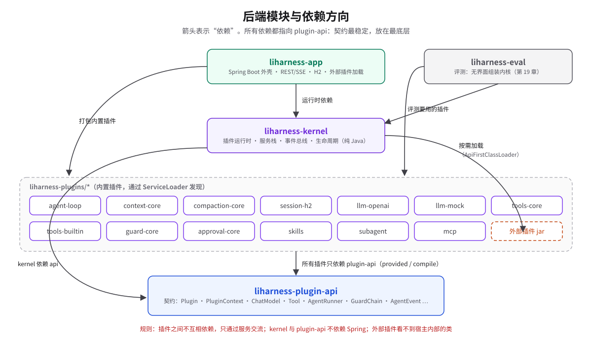
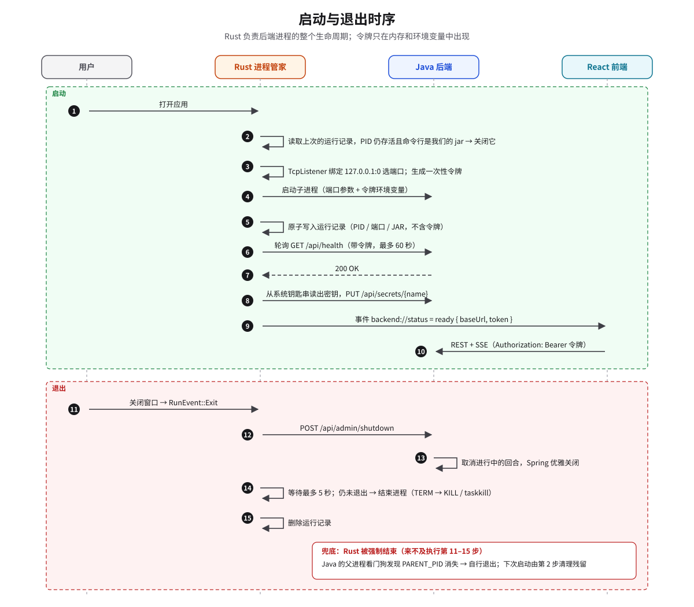
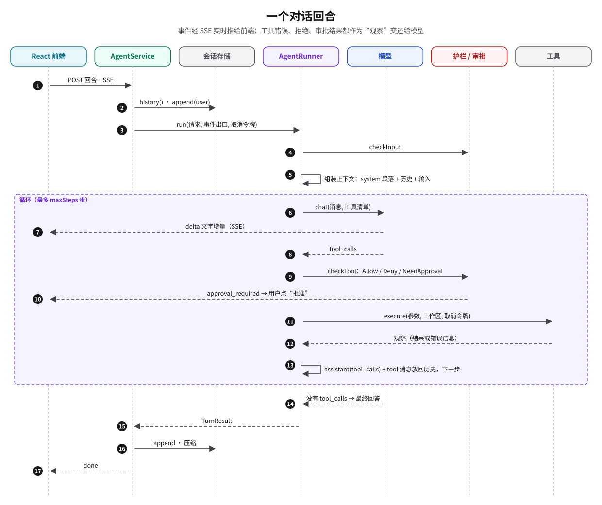

# 架构设计

> 这份文档描述 LiHarness 的**目标形态**。读教程时卡住了，回来对照“我现在写的这块在整张图的哪里”。

## 1. 一句话

> **Rust 进程管家 + React 本地控制台 + Java 智能体内核。**
> 智能体逻辑全部在 Java；桌面外壳只负责进程生命周期、本机能力和低延迟的流式交互。


## 2. 三层职责

| 层 | 负责 | 不负责 |
|---|---|---|
| **React 控制台** | 展示、交互、把事件流归一化成 UI 状态 | 不执行任何命令，不直接读写文件 |
| **Rust 进程管家** | 后端进程生命周期；令牌；本机能力（目录选择、Git 状态、外部跳转、通知、诊断） | 不包含任何智能体逻辑 |
| **Java 后端** | 智能体的一切：插件、Agent 循环、模型、工具、护栏、审批、会话、压缩 | 不感知自己运行在桌面还是服务器 |

**为什么这样切？** 智能体能力只在一个地方实现（Java），桌面版与将来的 Web 版、CLI 共用同一套后端；前端没有命令执行面，被注入了也做不了危险的事。

## 3. 后端模块与依赖方向



| 模块 | 依赖 | 说明 |
|---|---|---|
| `liharness-plugin-api` | 无 | **唯一的插件契约**：`Plugin`、`PluginContext`、服务接口（`ChatModel`、`ToolRegistry`、`SessionStore`…）、协议类型（`Message`、`ToolCall`…）、事件类型 |
| `liharness-kernel` | plugin-api | 插件加载、依赖解析、生命周期状态机、服务注册表、事件总线 |
| `plugins/*` | plugin-api | 每个能力一个模块，打成普通 jar |
| `liharness-app` | kernel + 内置插件 + Spring Boot | 启动入口；把内核事件暴露成 REST + SSE；H2；令牌校验；外部插件加载 |
| `liharness-eval` | kernel + 插件 | 无界面组装内核，跑评测用例（第 19 章） |

**规则：插件只能依赖 `plugin-api`。** 详见 [插件架构](plugin-architecture.md)。

`liharness-app` 内部**按功能分包**（`config` / `security` / `lifecycle` / `agent` / `session` / `settings` / `plugin`），而不是按 controller / service 分层：改一个功能只动一个目录，只在包内使用的类可以不写 `public`。

## 4. 启动流程



要点：

- **端口由 Rust 选**：`TcpListener::bind("127.0.0.1:0")` 让系统分配空闲端口，读出端口号后立即释放，再交给 Java。释放和 Java 绑定之间有极短的竞争窗口，Java 启动失败时 Rust 换一个端口重试。
- **运行记录**原子写入（先写临时文件再 rename），**不包含令牌**。
- **回收遗留进程**前核对进程的命令行确实包含我们的 jar 路径，防止 PID 被系统复用后误杀无关进程。
- **日志重定向**到 `<应用数据目录>/logs/backend.log`，就绪判断靠健康检查轮询，不依赖解析 stdout。

## 5. 退出流程

见上图第 11–15 步：Rust 收到 `RunEvent::Exit` 后请求 `POST /api/admin/shutdown`（Java 停止接收新回合、取消进行中的回合、H2 刷盘关闭），最多等 5 秒，超时只强制终止我们自己启动的那个子进程，最后删除运行记录。

Java 端还有一道保险：**父进程看门狗**。启动参数里带着 Tauri 进程的 PID，Java 每隔几秒用 `ProcessHandle.of(pid).isAlive()` 检查一次，父进程不在了（比如 Tauri 崩溃）就自行优雅退出，不会留下孤儿进程和 H2 文件锁。

## 6. 一次对话回合



SSE 事件类型（前端归一化的依据）：

| event | 含义 |
|---|---|
| `delta` | 模型输出的一小段文本 |
| `trace` | 执行时序图上的一条动线（谁调用了谁、耗时多少） |
| `tool_call` / `tool_result` | 工具调用与结果摘要 |
| `approval_required` / `approval_resolved` | 需要用户批准的操作 / 审批结果 |
| `context` | 本轮上下文构成统计 |
| `compacted` | 历史被压缩 |
| `done` | 回合结束（最终回答、模型名、token 用量） |
| `error` | 出错（可恢复 / 不可恢复） |

## 7. Agent Loop 的不变量

写错这些，模型 API 会直接返回 400，或者模型会“失忆”：

1. **assistant 的 tool_calls 消息必须原样放回上下文**，不能改写成普通文本；
2. **每个 `tool_call_id` 都必须有一条对应的 tool 消息**，被拒绝、执行失败、超时都要回填原因；
3. **没有 tool_calls 就是最终回答**，这是唯一的正常出口；
4. **最大步数保险丝**，防止死循环；
5. **工具错误不中断循环**，错误作为观察交给模型，让它自己修正。

## 8. 并发模型（JDK 17）

| 场景 | 做法 |
|---|---|
| Agent 回合 | 专用线程池（有上限）；每个会话同一时刻只允许一个回合 |
| SSE 推送 | `SseEmitter`；回合线程通过内核事件总线发事件，SSE 适配器订阅并写出 |
| 模型调用 | `java.net.http.HttpClient` 流式读取，逐行解析 |
| 审批等待 | `CompletableFuture` + 超时；用户的决定由 REST 接口完成这个 Future |
| 取消 | 每个回合一个取消令牌；在调模型前、执行工具前检查；HTTP 流读取时中断 |
| 工具子进程 | `ProcessBuilder` + 超时 + 销毁整个进程树 |

## 9. 数据落盘

```text
<应用数据目录>/
├── runtime/backend.json     # 运行记录：pid、port、jarPath、startedAt（无令牌）
├── db/liharness.mv.db       # H2 文件库：会话、追加式事件日志、模型配置、插件状态
├── plugins/                 # 外部插件 jar
├── skills/                  # 技能包
└── logs/backend.log         # 后端日志（已脱敏）
```

应用数据目录由 Rust 通过 `app.path().app_data_dir()` 取得，作为启动参数传给 Java。Java 不自己猜目录。

API Key 不进数据库，存放在系统钥匙串里（第 12 章）。

## 10. 安全边界

| 边界 | 措施 | 章节 |
|---|---|---|
| 其他程序 → 后端 | 只监听回环地址 + 随机端口 + 启动令牌；不开放 CORS | 01、02 |
| 前端 → 本机 | 前端没有命令执行能力；Tauri capability 只开放固定 command | 02、18 |
| 模型 → 命令 | 护栏策略链 + 人工审批 | 11 |
| 模型 → 文件 | 工作区沙箱 | 07 |
| 插件 → 系统 | 外部插件默认禁用；独立 ClassLoader；来源校验 | 14 |
| 密钥 → 日志 / 前端 | 钥匙串存储；日志与事件流脱敏 | 11、12 |
