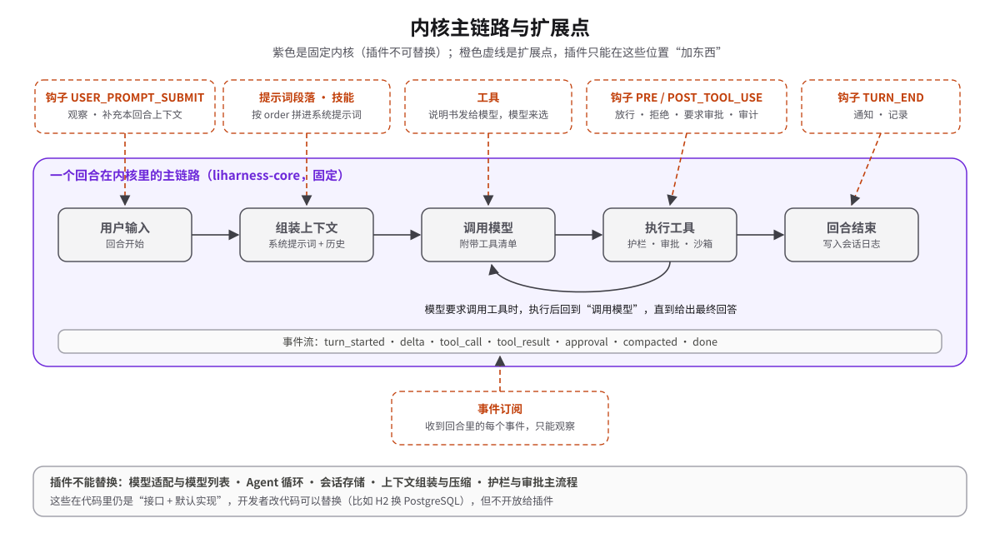

# 架构设计

> 这份文档描述 LiHarness 的**目标形态**，以及我们怎样分两个阶段走到那里。读教程时卡住了，回来对照“我现在写的这块在整张图的哪里”。

## 1. 一句话

> **Rust 进程管家 + React 本地控制台 + Java 智能体后端；后端是“固定内核 + 扩展点插件”。**

- 智能体逻辑全部在 Java；桌面外壳只负责进程生命周期、本机能力和流式交互。
- Java 后端里，**模型适配、Agent 循环、会话存储、上下文管理、护栏与审批是固定的内核**，插件不能替换它们。
- 插件只能通过几个明确的**扩展点**增加能力：工具、提示词段落、钩子、事件订阅、技能。


## 2. 两个阶段

| | 第一阶段：最小可用 Harness（MVP） | 第二阶段：完整 Harness |
|---|---|---|
| 目标 | 一个能用的桌面 Agent：对话、工具、护栏、会话、上下文、技能、子代理、MCP | 可扩展的平台：插件 SDK、外部插件、插件市场、多模型 |
| 后端模块 | `liharness-core` + `liharness-app` | 再加 `liharness-plugin-api`，app 里加插件宿主 |
| 怎么加一个工具 | 在 core 里写一个类，注册到工具表 | 写一个插件 jar，放进插件目录 |
| 模型 | 一份模型配置（OpenAI 兼容）+ Mock | 模型列表、默认模型、每个会话单独选 |
| 教程 | 第 00–13 章 | 第 14–19 章 |

**为什么先做 MVP？** 先把“模型在循环里调用工具”这件事完整跑通，你才会真正知道哪些地方需要扩展、扩展点该长什么样。一上来就设计插件系统，很容易设计出用不上的抽象。第一阶段的代码按“端口 + 实现”组织，第二阶段只是把其中几个接口提出来做成插件 SDK，不需要推倒重来。


## 3. 三层职责

| 层 | 负责 | 不负责 |
|---|---|---|
| **React 控制台** | 展示、交互、把事件流归一化成界面状态 | 不执行任何命令，不直接读写文件 |
| **Rust 进程管家** | 后端进程生命周期；令牌；本机能力（目录选择、Git 状态、外部跳转、通知、诊断） | 不包含任何智能体逻辑 |
| **Java 后端** | 智能体的一切：Agent 循环、模型、工具、护栏、审批、会话、上下文、插件宿主 | 不感知自己运行在桌面还是服务器 |

**为什么这样切？** 智能体能力只在一个地方实现（Java），桌面版与将来的 Web 版、CLI 共用同一套后端；前端没有命令执行面，被注入了也做不了危险的事。

## 4. 后端模块与依赖方向


| 模块 | 阶段 | 依赖 | 说明 |
|---|---|---|---|
| `liharness-core` | 一 | （二）plugin-api | **智能体内核，纯 Java，不依赖 Spring**：Agent 循环、模型端口与适配器、工具表与内置工具、护栏、上下文、会话端口、技能、子代理、MCP 客户端 |
| `liharness-app` | 一 | core + Spring Boot | 启动入口：REST + SSE、令牌校验、H2 会话存储、设置与密钥、进程生命周期；（二）插件宿主 |
| `liharness-plugin-api` | 二 | 无 | **插件 SDK**：`Plugin`、`PluginContext`、`Tool`、`HookPoint` 等。插件作者只依赖它 |
| 外部插件 jar | 二 | plugin-api（provided） | 第三方或你自己写的插件，放进插件目录即可加载 |

依赖规则：

- `core` 不依赖 Spring：它能在单元测试和评测程序里直接 `new` 出来运行；
- 插件只依赖 `plugin-api`，看不到 `core` 和 `app` 的内部类（独立类加载器保证）；
- `app` 内部**按功能分包**：`config` / `security` / `lifecycle` / `agent` / `session` / `settings` / `plugin`。

## 5. 内核与扩展点

这是第二阶段的核心设计，详见 [插件与扩展点](plugin-architecture.md)。一句话：

| 固定的内核（插件不能替换） | 开放的扩展点（插件可以增加） |
|---|---|
| 模型适配与模型列表 | 工具 |
| Agent 循环 | 提示词段落 |
| 会话存储（事件日志） | 钩子：会话开始、用户输入、工具调用前 / 后、回合结束 |
| 上下文组装与压缩 | 事件订阅 |
| 护栏与审批的主流程 | 技能（插件可以附带技能目录） |

内核的每一块在代码里仍然是“接口 + 默认实现”（端口与适配器）。**开发者**可以改代码替换实现（比如把 H2 换成 PostgreSQL），但这属于改项目本身，不属于插件能力。



## 6. 启动与退出


要点：

- **端口由 Rust 选**：`TcpListener::bind("127.0.0.1:0")` 让系统分配空闲端口，读出端口号后立即释放，再交给 Java。释放和 Java 绑定之间有极短的竞争窗口，Java 启动失败时 Rust 换一个端口重试。
- **运行记录**原子写入（先写临时文件再 rename），**不包含令牌**。
- **回收遗留进程**前核对进程的命令行确实包含我们的 jar 路径，防止 PID 被系统复用后误杀无关进程。
- **日志重定向**到 `<应用数据目录>/logs/backend.log`，就绪判断靠健康检查轮询，不依赖解析 stdout。
- **退出**：Rust 收到 `RunEvent::Exit` 后请求 `POST /api/admin/shutdown`，最多等 5 秒，超时只强制终止我们自己启动的那个子进程。
- **父进程看门狗**：Java 每隔 2 秒检查 Tauri 进程是否还在，不在了就自行优雅退出，不会留下孤儿进程。

## 7. 一次对话回合


SSE 事件类型（前端归一化的依据）：

| event | 含义 |
|---|---|
| `turn_started` | 回合开始 |
| `delta` | 模型输出的一小段文本 |
| `trace` | 执行时序图上的一条动线（谁调用了谁、耗时多少） |
| `tool_call` / `tool_result` | 工具调用与结果摘要 |
| `approval_required` / `approval_resolved` | 需要用户批准的操作 / 审批结果 |
| `context` | 本轮上下文构成统计 |
| `compacted` | 历史被压缩 |
| `done` | 回合结束（最终回答、模型名、token 用量） |
| `error` | 出错（可恢复 / 不可恢复） |

第二阶段的钩子插在这条链路的固定位置上：用户输入进来时（`USER_PROMPT_SUBMIT`）、每次执行工具前后（`PRE_TOOL_USE` / `POST_TOOL_USE`）、回合结束时（`TURN_END`）。钩子能观察、能拦截工具调用，但不能改变循环本身。

## 8. Agent Loop 的不变量

写错这些，模型 API 会直接返回 400，或者模型会“失忆”：

1. **assistant 的 tool_calls 消息必须原样放回上下文**，不能改写成普通文本；
2. **每个 `tool_call_id` 都必须有一条对应的 tool 消息**，被拒绝、执行失败、超时都要回填原因；
3. **没有 tool_calls 就是最终回答**，这是唯一的正常出口；
4. **最大步数保险丝**，防止死循环；
5. **工具错误不中断循环**，错误作为观察交给模型，让它自己修正。

## 9. 并发模型（JDK 17）

| 场景 | 做法 |
|---|---|
| Agent 回合 | 专用线程池（core = max = 8，有上限）；每个会话同一时刻只允许一个回合 |
| SSE 推送 | `SseEmitter`；回合线程把事件交给 SSE 出口写出 |
| 模型调用 | `java.net.http.HttpClient` 流式读取，逐行解析 |
| 审批等待 | `CompletableFuture` + 超时；用户的决定由 REST 接口完成这个 Future |
| 取消 | 每个回合一个取消令牌；在调模型前、执行工具前检查；HTTP 流读取时中断 |
| 工具子进程 | `ProcessBuilder` + 超时 + 销毁整个进程树；去掉 `LIHARNESS_` 开头的环境变量 |

## 10. 数据落盘

```text
<应用数据目录>/
├── runtime/backend.json     # 运行记录：pid、port、jarPath、startedAt（无令牌）
├── db/liharness.mv.db       # H2 文件库（第 10 章起）：会话、事件日志、设置
├── skills/                  # 技能包
├── plugins/                 # 外部插件 jar（第二阶段）
└── logs/backend.log         # 后端日志（已脱敏）
```

应用数据目录由 Rust 通过 `app.path().app_data_dir()` 取得，作为启动参数传给 Java。API Key 不进数据库，存放在系统钥匙串里，只在 Java 内存中出现。

## 11. 安全边界

| 边界 | 措施 | 章节 |
|---|---|---|
| 其他程序 → 后端 | 只监听回环地址 + 随机端口 + 启动令牌；不开放 CORS | 01、02 |
| 前端 → 本机 | 前端没有命令执行能力；Tauri capability 只开放固定 command | 02、18 |
| 模型 → 文件 | 工作区沙箱 | 06 |
| 模型 → 命令 | 护栏策略 + 人工审批 | 09 |
| 密钥 → 日志 / 前端 | 钥匙串存储；日志与事件流脱敏 | 07、09 |
| 插件 → 内核 | 只能通过扩展点增加能力，不能替换内核；独立类加载器 | 15、16 |
| 插件 → 系统 | 外部插件默认停用；来源与 SHA-256 校验；权限与应用相同，只装可信插件 | 16、17 |
