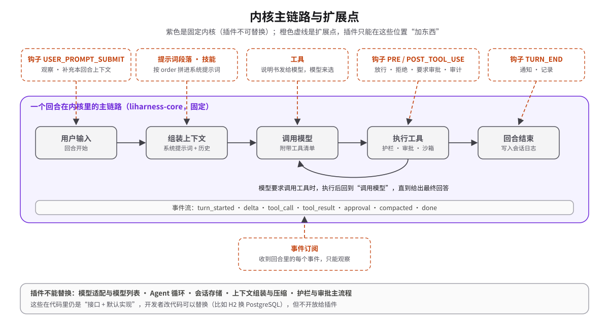
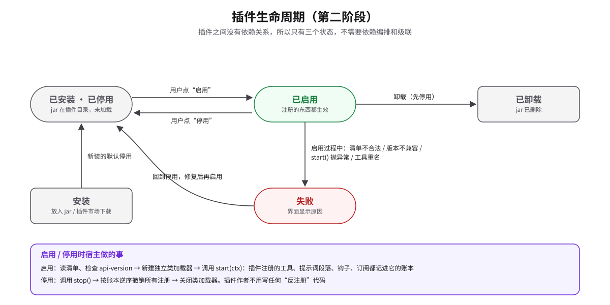

# 插件与扩展点

> 第二阶段（第 14–17 章）的设计。第一阶段没有插件系统，但代码按这里的边界组织，方便第二阶段直接把扩展点提出来。

## 1. 设计原则

**插件只能“加能力”，不能“换内核”。**

| | 允许 | 不允许 |
|---|---|---|
| 插件 | 注册工具、加提示词段落、挂钩子、订阅事件、附带技能 | 替换模型适配、Agent 循环、会话存储、上下文组装、护栏与审批主流程 |

为什么这样定：

1. **用户真正需要的是加能力。** 做 PPT、查 Jira、调公司内部系统，都是“加一个工具 + 告诉模型什么时候用”。替换 Agent 循环这类需求，只有拿项目做二次开发的开发者才有，而他们可以直接改代码。
2. **扩展点都是“集合型”的，没有冲突问题。** 工具可以有一百个，钩子可以有十个。不存在“两个插件都想当 Agent 循环，到底用哪个”的问题，也就不需要依赖排序、提供者栈、级联重载这些复杂机制。
3. **内核稳定，问题好排查。** 出了问题，循环、存储、模型调用这条主链路永远是同一套代码，不会因为用户装了什么插件而变样。

内核在代码里依然是“接口 + 默认实现”。比如 `ISessionRepository` 是接口，`JsonlSessionRepository` 是实现。开发者可以改代码换实现，但这是改项目本身，不是插件能力。

## 2. 扩展点一览



| 扩展点 | 插件怎么用 | 内核怎么用 | 多个插件同时使用时 |
|---|---|---|---|
| **工具** | `ctx.registerTool(tool)` | 每轮把所有工具的说明书发给模型；模型选中后执行 | 工具名必须唯一，重名的插件加载失败 |
| **提示词段落** | `ctx.registerPromptSection(name, order, text)` | 组装系统提示词时按 `order` 排序拼进去 | 都保留，按 `order` 排 |
| **钩子** | `ctx.registerHook(HookPoint, hook)` | 在固定时机调用，见第 4 节 | 都执行，按安装顺序 |
| **事件订阅** | `ctx.subscribe(AgentEvent 类型, handler)` | 回合中的每个事件都会广播 | 都收到，互不影响 |
| **技能** | 插件 jar 里附带 `skills/` 目录 | 和用户技能一起进入技能目录 | 优先级：项目级 > 用户级 > 插件 |

模型不是扩展点。用户在设置页添加模型配置（OpenAI 兼容协议填 Base URL、模型名、Key），这属于**配置**，不需要插件。

## 3. 插件 SDK（`liharness-plugin-api`）

插件作者只依赖这一个模块，而且用 `provided` 作用域（运行时由宿主提供）。

```java
/** 插件入口。一个 jar 一个插件 */
public interface Plugin {

    /** 和清单里的 id 一致 */
    String id();

    /** 启用时调用：在这里注册工具、提示词、钩子……注册的东西在停用时自动撤销 */
    void start(PluginContext ctx);

    /** 停用前调用：释放插件自己创建的资源（线程、连接等）。可以不实现 */
    default void stop() {
    }
}
```

```java
/** 插件和宿主之间唯一的窗口 */
public interface PluginContext {

    String pluginId();

    /** 注册一个工具。返回的 Registration 可以提前撤销；不撤销的话停用时自动撤销 */
    Registration registerTool(Tool tool);

    Registration registerPromptSection(String name, int order, String text);

    Registration registerHook(HookPoint point, Hook hook);

    <E extends AgentEvent> Registration subscribe(Class<E> type, Consumer<? super E> handler);

    /** 插件配置：来自插件工作台的设置 */
    Optional<String> config(String key);

    /** 插件专属的数据目录 */
    Path dataDir();

    /** 登记一个停用时要关闭的资源 */
    void onStop(AutoCloseable resource);
}
```

`Tool`、`ToolContext`、`ToolResult`、`ToolArgs`、`ToolException` 从第 05 章起就在 `plugin-api` 里（`com.pubbge.liharness.domain.spi.tool`），`core` 依赖 `plugin-api`。内置工具、MCP 工具（第 13 章）和插件工具用的是同一个接口。第 15 章只是在旁边加上 `Plugin`、`PluginContext`、钩子等类型。

第一阶段里已经存在、第 15 章要“提升”为扩展点的接缝：

| 第一阶段的代码 | 第 15 章变成 |
|---|---|
| `TurnTools.forTurn()` 每个回合组装工具 | 加上所有已启用插件注册的工具 |
| `SystemPromptBuilder` + 段落顺序（100…900，中间留空） | `registerPromptSection` 插入段落 |
| `ToolGate`（第 09 章的规则链） | `PRE_TOOL_USE` 钩子包装成一个 gate |
| `ITurnEventListener.compose(...)` | `subscribe` 的事件分发 |
| `SkillCatalog.load(userDir, workspace)` | 再加上插件 jar 里附带的技能目录 |

## 4. 钩子

钩子在 Agent 循环的固定位置被调用，能观察、能拦截工具调用，但不能改变循环本身。

| 时机 `HookPoint` | 触发时 | 钩子能做什么 |
|---|---|---|
| `SESSION_START` | 新会话创建 | 观察（比如初始化插件自己的状态） |
| `USER_PROMPT_SUBMIT` | 用户发出一句话，回合开始前 | 观察；补充一段只对本回合生效的上下文 |
| `PRE_TOOL_USE` | 每次执行工具前 | 放行 / 拒绝（附原因）/ 要求人工审批 |
| `POST_TOOL_USE` | 每次执行工具后 | 观察结果（审计、统计） |
| `TURN_END` | 回合结束 | 观察（通知、记录） |

多个 `PRE_TOOL_USE` 钩子的结果合并规则和内置护栏一样：**拒绝 > 要求审批 > 放行**。任何一个钩子拒绝，工具就不会执行，原因作为观察交给模型。

钩子抛异常或超时（默认 5 秒），按“放行”处理并记录警告，不能让一个写坏的插件卡住所有回合。

## 5. 插件宿主（`liharness-app` 的 `plugin` 包）

### 生命周期



| 状态 | 含义 |
|---|---|
| 已停用 | 已安装（jar 在插件目录里），没有加载。**新安装的外部插件默认在这个状态** |
| 已启用 | 已加载，`start()` 执行成功，注册的东西都生效 |
| 失败 | `start()` 抛了异常，或者清单不合法、版本不兼容；界面上显示原因 |

插件之间**没有依赖关系**，所以不需要依赖排序和级联：每个插件只和宿主打交道。

### 自动撤销

宿主给每个插件一个 `PluginContext`，它把插件注册的每一样东西都记进这个插件的账本。停用时，宿主先调用插件的 `stop()`，再按账本逆序撤销所有注册，最后关闭插件的类加载器。插件作者不需要写任何“反注册”代码。

### 清单 `META-INF/liharness-plugin.properties`

```properties
id=acme-ppt
name=PPT 生成
version=1.2.0
api-version=1.0
description=根据大纲生成 PowerPoint 文件
```

`api-version` 和宿主的 `plugin-api` 版本比较：主版本相同、次版本不高于宿主才加载，否则拒绝并说明原因。

### 类加载隔离

每个外部插件一个类加载器，父加载器是 JDK 的平台类加载器，只有 `plugin-api` 的包交给宿主加载。插件看不到 `core`、`app`、Spring 和宿主的依赖，也不会和宿主的依赖版本冲突。

> 类加载隔离不是安全沙箱：插件和应用拥有相同的权限。只安装信任的插件；不可信的能力用 MCP 服务器（独立进程）接入。

### 工具命名

插件注册的工具名原样暴露给模型，由插件作者保证有辨识度（比如 `ppt_create`）。重名时后加载的插件进入“失败”状态并显示原因，不会悄悄覆盖。

## 6. 四种接入外部能力的方式

| 方式 | 适合 | 进程 | 阶段 |
|---|---|---|---|
| 内置工具（改 core） | 项目本身的核心能力 | 同一进程 | 一 |
| MCP 服务器（配置） | 复用现成的 MCP 生态；不可信或其他语言写的工具 | 独立进程 | 一 |
| 技能（`SKILL.md`） | 教模型“怎么做好”某件事，不需要写代码 | — | 一 |
| Java 插件 jar | 需要工具 + 提示词 + 钩子组合在一起的能力包 | 同一进程，独立类加载器 | 二 |

## 7. 和其他产品的对比

| | 加工具 / 技能 / MCP | 钩子 | 换模型 | 换 Agent 循环、会话存储 |
|---|---|---|---|---|
| Claude Code、Codex | 支持 | 支持 | 配置 | 不支持 |
| 扩展点式 Java Harness | 支持 | 支持 | 配置 | 改代码 |
| DeepSeek Harness | 支持 | 支持 | 插件 | 插件 |
| **LiHarness** | **支持** | **支持** | **配置（模型列表）** | **改代码** |

LiHarness 选的是左边三行的路线：能力可以无限扩展，内核保持固定。
