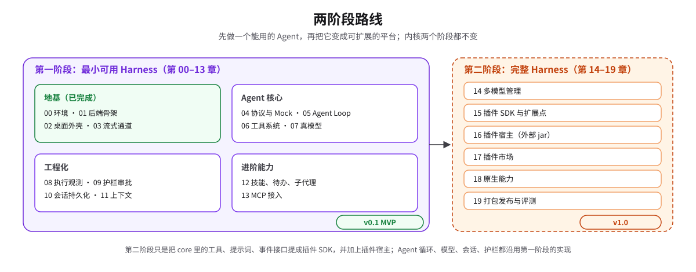

# 路线图

每个里程碑对应一章教程，**做完一章打一个 tag**（如 `m05-agent-loop`），方便回看每一步的样子。

图例：⬜ 未开始 · 🟨 进行中 · ✅ 完成（这里记录**你自己**的实现进度）

## 第一阶段：最小可用 Harness（MVP）

目标：一个能日常使用的桌面 Agent。没有插件系统，所有能力写在 `liharness-core` 里，但按“接口 + 实现”组织，为第二阶段留好边界。

### 地基：窗口里能看到后端在跑

| | 里程碑 | 教程 | 交付物 | 验收 |
|---|---|---|---|---|
| ✅ | M0 环境 | [00](guide/00-setup.md) | JDK 17、Node、Rust、Tauri 依赖 | 版本检查全部通过 |
| ✅ | M1 后端骨架 | [01](guide/01-backend-skeleton.md) | Maven 多模块、Spring Boot 3.4.1、standalone profile、令牌过滤器、父进程看门狗、关闭接口 | 带令牌访问 `/api/health` 返回 UP，不带令牌返回 401 |
| ✅ | M2 桌面骨架 | [02](guide/02-desktop-shell.md) | Tauri 2 + React 19；Rust 进程管家 | 打开应用自动拉起后端；关闭后没有残留 Java 进程 |
| ✅ | M3 流式通道 | [03](guide/03-streaming.md) | SSE、回合线程池、Tauri HTTP 插件、前端事件归一化 | 窗口里逐字显示后端推送的演示回答 |

### Agent 核心：能调工具的 Agent

| | 里程碑 | 教程 | 交付物 | 验收 |
|---|---|---|---|---|
| ⬜ | M4 协议层与 Mock 模型 | 04 | 新建 `liharness-core`；`Message`、`ToolCall`、`ChatModel` 接口；`MockChatModel` | Mock 对“几点了”返回 `get_time` 调用 |
| ⬜ | M5 最小 Agent Loop | 05 | `AgentLoop`：五条不变量、最大步数、取消令牌；接入 SSE | 窗口里问“几点了”，看到“调工具 → 回答” |
| ⬜ | M6 工具系统 | 06 | `Tool` 接口与工具表；时间、计算器、fs 五件套、`run_command`、`web_fetch`；工作区沙箱 | 工具出错时模型能看到错误并自我修正；`../` 越界被拒绝 |
| ⬜ | M7 对接真模型 | 07 | OpenAI 兼容流式客户端、tool_calls 分片拼接；模型设置页；API Key 存钥匙串 | 接上 DeepSeek 等真实模型逐字输出 |

### 工程化：靠得住

| | 里程碑 | 教程 | 交付物 | 验收 |
|---|---|---|---|---|
| ⬜ | M8 执行观测 | 08 | Trace 事件、执行时序图、停止生成 | 每一步调用实时出现在时序图上 |
| ⬜ | M9 护栏与审批 | 09 | 护栏策略链、审批卡片、命令白名单、输出脱敏 | 白名单外命令弹出审批；超时自动拒绝 |
| ⬜ | M10 会话持久化 | 10 | 引入 H2 + Flyway；追加式事件日志；多会话与工作区 | 重启后会话还在 |
| ⬜ | M11 上下文管理 | 11 | 系统提示词组装、token 估算、上下文面板、阈值压缩 | 长对话自动压缩且保持连贯 |

### 进阶能力

| | 里程碑 | 教程 | 交付物 | 验收 |
|---|---|---|---|---|
| ⬜ | M12 技能、待办与子代理 | 12 | `SKILL.md` 渐进式披露、`todo` 工具、`delegate_task` 子代理 | 命中技能时按说明执行；子代理过程不进入主上下文 |
| ⬜ | M13 MCP 接入 | 13 | stdio MCP 客户端，远端工具接入工具表，默认需要审批 | 连上官方 filesystem 服务器并调用其工具 |

**🎯 v0.1 MVP**：第一阶段完成。可以本地打包自用（第 19 章的打包脚本提前用也可以）。

## 第二阶段：完整 Harness

目标：从“一个 Agent”变成“一个可扩展的平台”。内核保持不变，开放扩展点。

| | 里程碑 | 教程 | 交付物 | 验收 |
|---|---|---|---|---|
| ⬜ | M14 多模型管理 | 14 | 模型列表（`ModelRegistry`）、默认模型、每个会话单独选；可选的备用模型 | 同时配置 3 个模型，会话间切换无需重启 |
| ⬜ | M15 插件 SDK 与扩展点 | 15 | 新建 `liharness-plugin-api`；工具、提示词段落、钩子、事件订阅、技能五个扩展点；内置工具迁到同一接口 | 一个内置“插件”通过扩展点注册工具和钩子，停用后全部撤销 |
| ⬜ | M16 插件宿主 | 16 | 外部插件 jar、清单与版本检查、独立类加载器、启用 / 停用、插件工作台、示例插件 | 不重启应用，安装一个外部插件并被模型调用 |
| ⬜ | M17 插件市场 | 17 | 插件目录、下载、SHA-256 校验、更新与卸载 | 在界面里浏览并安装一个插件 |
| ⬜ | M18 原生能力 | 18 | 目录选择、通知、Git 状态、诊断面板、登录 shell 的 PATH | 后端挂掉时诊断面板仍可用 |
| ⬜ | M19 打包发布与评测 | 19 | jlink 精简 JRE、三平台 CI、评测集 | Release 出现三平台安装包；评测输出通过率 |

**🎯 v1.0**：第二阶段完成。

## 以后再说

- 插件签名与可信发布者
- MCP Streamable HTTP 传输、自动更新
- 团队服务器模式（同一后端供多人使用，接入企业 SSO）
- 多 Agent 协作（规划者 / 执行者 / 评审者）
- 升级到 JDK 21+ 并切换虚拟线程
